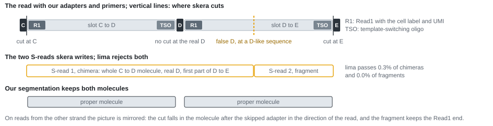

<!-- Generated by docs/build_docs.py from README.md.in; edit that file, then run `uv run python docs/build_docs.py`. -->
# flight-kinnex-qc

[](https://doi.org/10.5281/zenodo.24092254)

The code and results behind the FLIGHT-seq manuscript's Supplementary Note on Kinnex array integrity: what goes wrong when PacBio's Kinnex 8-fold kit joins single-cell cDNA molecules into arrays, how often, and how many usable molecules it costs. It also installs `kinnex-qc`, a command that checks the array structure and artifact molecules (TSO-TSO, R1-R1, missing primers) in your own Kinnex HiFi reads and, with skera's S-reads, skera's cuts.

## What we found

The data: FLIGHT-seq full-length cDNA from one BD Rhapsody cartridge (a bead-based single-cell capture kit), split into three libraries, each made into Kinnex 8-fold arrays and sequenced on one Revio SMRT Cell: ND, with no TSO-TSO depletion; HM, depleted by a home-made biotin-Read1 pulldown; and kin, depleted by the Kinnex TSO artifact removal. For comparison, the public ArgenTag 8-fold dataset from the MDA-MB-453 cell line. The terms are explained in [docs/concepts.md](docs/concepts.md).

**1. skera cuts some arrays in the wrong place.** Observed with skera 26.1.0, the version that wrote our S-reads: in complete arrays that skera passes, 8.6% to 8.8% of reads carry at least one false cut, in all three libraries alike. skera skips a real adapter, most often D (75% of the skipped adapters we find in ND), and cuts instead at a similar sequence a median 891 bp into the next molecule. Two S-reads come out wrong. The one before the cut is a chimera: a whole molecule, then the real adapter skera did not cut at, then the start of the next molecule. The one after it is a fragment, the rest of that molecule. lima passes 0.0% of the fragments and 0.3% to 0.4% of the chimeras, so each false cut costs two molecules. skera's documentation does not say how closely a sequence must match an adapter, and `skera split` has no option for it. Details, numbers per library and PacBio's own words: [docs/skera_cutting_error.md](docs/skera_cutting_error.md).



One such read from ND, as stored in `examples/example_reads.fasta` (record `skera_false_cut`). Uppercase marks the adapters and the false cut, the site skera called D; positions are on the stretch of the read shown in the record. The coloured view is `examples/example_reads.html`.

```text
>skera_false_cut BD144_ND zm=1576268 read positions 2723-5795 of 14028 (adapter C to adapter E)
   1 ACTCTGTCAGGTCCGATctacacgacgctcttccgatctagatcggagcgtgatggagtcttgacaaggttctaggcaagcctttttttttttttttttt
     ^^^^^^^^^^^^^^^^^ C 1-17: adapter C
...
1001 ccagggcctccgggcccccccgctgcaccggcgtcatccgccatttggtgttttgtcggaaaagaagcccatgtactctgcgttgataccactgcttACC
1101 TCCTCCTCCAGAATctacacgacgctcttccgatctccttcgaccgtgattgatgtatgacataccaggactcttccagttttttttttttttttttttt
     ^^^^^^^^^^^^^^ D(real) 1098-1114: the real adapter D, which skera skips (it starts on the line above)
...
2201 attaaccgcatattccttattatcaacatttccctgcgatttcttgcaatttGCATACTCCTCCAGAATtgcatctacatttttcttggcagggagttga
                                                         ^^^^^^^^^^^^^^^^^ skera_D 2253-2269: the look-alike where skera cuts and writes D
```

**2. TSO-TSO molecules make mirror arrays, and skera leaves many of their molecules unwritten.** Without depletion, 16.1% of HiFi reads are mirror arrays, and 98.9% of their mirror junctions (an adapter followed by its own reverse complement) hold a TSO-TSO molecule. With the HM or kin depletion the share falls to 0.095% and 0.015%. A mirror read holds 3.74 usable molecules, against 8.00 in a complete read. With the standard workflow (skera, lima, isoseq refine, mapping), ND gets 12.6% fewer molecules per HiFi read into the mapped BAM than kin. Cutting every HiFi read at our own adapters narrows the gap to 8.7%. skera leaves many molecules of mirror arrays unwritten (observed), and in our test those molecules mapped as often as molecules of complete arrays (99.1% against 99.1%).

**3. Long molecules get slightly shorter partners.** For long cDNA molecules (4 kb or more), their partners in the same array average 9 to 11 bp shorter than if their lengths were randomly shuffled across arrays, under 1% of the mean partner. A limit on total array length explains it; neighbours in an array show at most a small preference by length.

**4. ArgenTag cDNA makes mirror arrays too.** 6.0% of ArgenTag's 8-fold HiFi reads are mirror arrays, with 7.6 TSO-TSO molecules per 1,000, although ArgenTag describes its cDNA as TSO artifact-free. We counted them in the whole reads that skera did not pass; mirror reads that skera passed are missing, so the share is a slight underestimate.

The Supplementary Note has every figure and table: `report/supplementary_note.html` and `report/supplementary_note.pdf`, with the source data of each figure in `report/tables/` and every number of its text in `report/numbers.json`.

## Check your own data

`kinnex-qc` needs Python 3.12 and none of the PacBio tools. From a copy of this repository, install the command with either of:

```
uv tool install .
pip install .
```

To try it without data, make the six synthetic reads the tests use (three complete arrays, one of them with a false cut, two TSO-TSO mirrors and an R1-R1 mirror, with their S-reads) and check all six, from the repository folder (after `pip install .`, plain `python` works in place of `uv run python`):

```
uv run python tests/make_test_bam.py qc/test_bam
kinnex-qc run --hifi qc/test_bam/hifi.bam --sreads qc/test_bam/sreads.bam --fraction 1 --out qc/
```

On your own data, run it on the HiFi BAM of one SMRT Cell, with skera's S-read BAM if you have it:

```
kinnex-qc run --hifi hifi_reads.bam --sreads segmented.bam --out qc/
```

By default it checks a hash sample of 10% of the ZMWs (`--fraction`) and writes `qc/report.html`, a page that explains each number it shows: the share of complete, truncated and mirror arrays, the molecule at each mirror junction, artifact molecules per 1,000 and a few example reads from your data. With `--sreads` it adds skera's false cuts, what skera writes from mirror arrays, and how many usable molecules per read skera does not write cleanly. The same numbers are in `qc/summary.json`, one row per checked read in `qc/reads.tsv.gz`. With `--write-molecules` it also writes `qc/molecules.bam`: every usable molecule of every read, cut at our adapters, ready for lima in place of skera's `segmented.bam`. How to read the report: [docs/reader_guide.md](docs/reader_guide.md).

Scope: single-cell 3' cDNA in Kinnex arrays, with the TSO at one end of each molecule and Read1 with the cell label at the other (BD Rhapsody and FLIGHT-seq, 10x 3', ArgenTag). It is not for bulk Iso-Seq, where both cDNA ends carry the same primer. So far it is validated on BD Rhapsody (FLIGHT-seq) Kinnex 8-fold libraries only.

## Reproduce the study

**Data.** The proposed deposit of the three BD144 libraries, under ACCESSION_TBD, holds per SMRT Cell the HiFi and fail reads, skera's `segmented.bam` and `segmented.non_passing.bam`, the ZMW metrics and skera's report, and per library the mapped fltnc BAM. The ArgenTag S-reads are public. The reference genome is GENCODE's GRCh38 primary assembly. [docs/data.md](docs/data.md) lists every file, where it comes from, the status of ArgenTag's file of non-passing reads, and where each path goes in the configuration.

**Software.** `uv sync` installs the Python side from `uv.lock`; `study/run_study.sh` runs every step with the interpreter in `.venv`. Three conda environments hold the other tools, under the names `study/study.toml` expects:

```
conda env create -f envs/pbtools.yml      # kinnex-qc-pbtools: lima 2.13.0, isoseq 4.3.0, minimap2 2.30
conda env create -f envs/samtools113.yml  # kinnex-qc-samtools113: samtools and htslib 1.13, to rebuild the calibration set
conda env create -f envs/skera120.yml     # kinnex-qc-skera120: skera 1.2.0, for the skera version check
```

**Inputs.** The study reads plain files. If you start from the instrument's archives, `study/prepare_inputs.sh MEMBER_TABLE OUT_DIR` extracts the six files of each SMRT Cell (its header lists the columns of the member table). Copy `study/samples.tsv` to `study/samples.local.tsv` and replace `<deposit>` with your folder. In `study/study.local.toml`, which is laid over `study/study.toml`, set `samples` to that file and `out_root`, `argentag_dir` and `reference_fasta` to your folders. git ignores both `.local` files.

**Run.**

```
study/run_study.sh
```

It runs the pipeline (stages 01 to 07 and their validation gates) on the three libraries, then the calibration set, the analyses, the ArgenTag comparison and the report steps, which write the Supplementary Note into the run's `report/` folder. Each finished step leaves a marker, so a rerun resumes where it stopped; `study/run_study.sh --help` lists the options.

**Rebuild the Note.** The render step alone rebuilds the Note in `report/` (the HTML, the PDF and `figures/`) from `report/tables/`, `report/numbers.json` and `report/fig3_reads.json`, without running the study:

```
uv run python study/report/render.py --report-dir report
```

It prints the PDF with Google Chrome, which it calls as `google-chrome`, and needs Inkscape for the PDF copies of the two drawings.

**Time and disk**, as measured on our machine (32 CPUs, 117 GiB of memory, shared with other jobs). The instrument archives of the three cells take 438 GiB, the extracted files 422 GiB (135 to 146 GiB per cell). `prepare_inputs.sh` refuses to start with less than 450 GiB free (`MIN_FREE_GB`). Extracting the three cells in parallel took about 3 hours. The mapped fltnc BAMs add 37 to 44 GiB each. In our full rerun, the validation gates and stages 01 to 05 took 10 hours with the three libraries in parallel; stage 06 runs one library at a time and took 64, 56 and 69 minutes on BD144_kin, BD144_ND and BD144_HM. The calibration set, the analyses and ArgenTag took 46 minutes more, the report steps under a minute, and the whole `run_study.sh` 14 hours. Its out root takes 151 GiB: 45 to 53 GiB per library, most of it lima and refine BAMs, 2.2 GiB for the calibration set and less than 0.5 GiB for the analyses, ArgenTag and the Note.

**Tests.** `uv sync --extra dev`, then `uv run python -m pytest`. Without the dev extra, `uv run pytest` can pick up a pytest from outside the project's environment. Tests that need the study's data are skipped unless `KINNEX_QC_REAL=1` is set.

## Documentation

- [docs/concepts.md](docs/concepts.md): Kinnex arrays, skera, mirror arrays, false cuts, and a glossary.
- [docs/skera_cutting_error.md](docs/skera_cutting_error.md): the skera cutting error, how often, what it costs, what PacBio documents, how to check your data.
- [docs/reader_guide.md](docs/reader_guide.md): installing and running `kinnex-qc`, reading its report, and how it was validated.
- [docs/data.md](docs/data.md): every input file and where it comes from.
- [docs/manuscript_methods.md](docs/manuscript_methods.md) and [docs/supplementary_methods.md](docs/supplementary_methods.md): Methods text for the manuscript.
- [examples/example_reads.html](examples/example_reads.html): five annotated reads (complete array, TSO-TSO mirror, R1-R1 mirror, double mirror, skera false cut).
- [CHANGELOG.md](CHANGELOG.md): every way this code's results differ from v10, the earlier build of the Note it was ported from, with the reason.

The numbers in README.md and docs/ are written by `uv run python docs/build_docs.py` from the `.md.in` files and `numbers.json`.

## Citation

Please cite the FLIGHT-seq manuscript and this repository, archived on Zenodo: https://doi.org/10.5281/zenodo.24092254 (the DOI of every version; each release also has its own). `CITATION.cff` has the details.

## Licence

MIT, see `LICENSE`. The fonts in `resources/fonts/`, embedded in the Supplementary Note, are under the SIL Open Font License 1.1.
